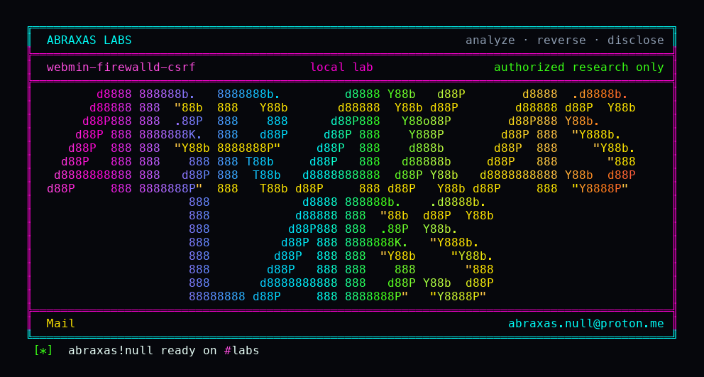

<p align="center">
  
</p>

# webmin-firewalld-csrf

Webmin's referer check treats every module's `index.cgi` as safe. FirewallD's index is not a dashboard. `?defzone=1&zone=trusted` returns 302 to `default_zone.cgi`, which runs `firewall-cmd --set-default-zone trusted`. The session cookie is SameSite=Lax, so a normal click from a foreign page still sends it. Direct GET of the setter with a foreign Referer is the Security Warning. The hop through index is not.

You are logged into the FirewallD module. Someone gets you to open a link. Your default zone becomes trusted, which is ACCEPT. They never had your password. You never confirmed a form. Logged out, this does nothing. A POST from a foreign site would not send a Lax cookie. This path is a GET.

**Class:** CSRF
**Reach:** Remote (logged-in firewalld user, top-level GET, SameSite=Lax)

**Webmin** 2.670 (`3a2b2b86`) - Webmin

| | |
|---|---|
| ID | no CVE yet |
| Class | **CSRF** |
| Reach | **Remote** (logged-in FirewallD user, top-level GET, SameSite=Lax) |
| CWE | [CWE-352](https://cwe.mitre.org/data/definitions/352.html) |
| CVSS | **High: 8.0** `CVSS:3.1/AV:N/AC:L/PR:N/UI:R/S:U/C:N/I:H/A:H` |
| Product | [Webmin](https://github.com/webmin/webmin) |
| Affected | **2.670** tag `2.670` (`3a2b2b8671c0669c129f5275b3dd1853106ae02b`) |
| Auth | Victim Webmin session with the FirewallD module. No CSRF token. Cookie is SameSite=Lax unless `no_samesite` is set. |
| License | [GNU Affero GPL v3.0](LICENSE) |
| Lab | `127.0.0.1:18450` only |

## What an attacker can do

Needs the victim already signed in with FirewallD. Default root can. The CGI runs `firewall-cmd` as the miniserv user, usually root. No extra ACL on this action. The host has to be Linux with FirewallD; the module ships `os_support=*-linux`.

| Privilege | Method / sink | Recon / integrity / availability | Lab-proven or inferred |
|---|---|---|---|
| Set the default firewalld zone to `trusted` (ACCEPT) | GET `/firewalld/index.cgi?defzone=1&zone=trusted` with a foreign Referer; 302 to `default_zone.cgi`; `firewall-cmd --set-default-zone trusted` | Integrity + availability (host firewall) | Lab-proven. Witness `WEBMIN-H24-FIREWALLD-CSRF --set-default-zone trusted`. Hops `302,302,200` |
| Same setter for any existing zone name | Same index hop with `zone=` of a built-in zone (`drop`, `public`, …) | Integrity + availability | Inferred. Lab used `trusted`. `default_zone.cgi` greps `list_firewalld_zones` |
| Negative control: hit the setter with a foreign Referer | GET `/firewalld/default_zone.cgi?zone=trusted` | n/a | Lab-proven. Status 200, body `Security Warning`, witness empty |
| Negative control: no session | Same GET without `sid` | n/a | Closed. miniserv login gate |

**Stays closed on this leftover**

| Axis | Method / sink | Why it is closed |
|---|---|---|
| Integrity | Direct `default_zone.cgi` from a foreign origin | `referers_none=1` plus host mismatch. Security Warning |
| Integrity | Cross-site POST | SameSite=Lax does not send the cookie on a cross-site POST |
| Integrity | `delete_zone.cgi` / `zone_form.cgi` from the same index buttons | Delete asks for confirm. Create is a POST form. Direct CGI still has a Referer check |
| Integrity | Unauthenticated FirewallD | Login required |
| Integrity | Clickjacking, `setup.pl` with referers off | Not this path. Package `setup.sh` writes `referers_none=1` |

The referer check is not broken on the setter. It is skipped on the page that 302s into the setter. After the 302 the browser's Referer is the Webmin index URL, so the second hop matches `HTTP_HOST` and goes through.

## How I found it

CSRF class on tag 2.670. `web-lib-funcs.pl` sets `trust=1` when `SCRIPT_NAME` is `/<module>/index.cgi`. `firewalld/index.cgi:21` is the odd index: `defzone` calls `&redirect("default_zone.cgi?zone=...")`. miniserv turns that Location into 302 (`miniserv-lib.pl:2484`). `default_firewalld_zone` runs `--set-default-zone` with no confirm. Cookie `SameSite=Lax` unless `no_samesite` (`miniserv-lib.pl:3236`).

Wrong turns: treating `default_zone.cgi` as the CSRF (foreign Referer is blocked); treating `referers_none=1` as closed; treating this as the old `setup.pl` referer-off XSS; treating it as clickjacking; looking for a POST (Lax would not send the cookie).

## Lab

```bash
python3 webmin-firewalld-csrf-Abraxas-Labs.py
```

or:

```bash
cd lab
./run.sh
```

Clones [webmin/webmin](https://github.com/webmin/webmin) tag `2.670` (`3a2b2b86`) into `lab/src`, builds `webmin-lab:2.670` if missing, and talks to `http://127.0.0.1:18450`. The container has no firewalld. `lab/firewall-cmd` is a PATH stub that logs `--set-default-zone`. Loopback only. Docker, git, python3.

```text
IOC image=webmin-lab:2.670 label-version=2.670 file-version=2.670
IOC login-server=MiniServ sid=1
IOC negative-status=200 warning=1 witness-empty=1
IOC csrf-hops=302,302,200 first-location=http://127.0.0.1:18450/firewalld/default_zone.cgi?zone=trusted
IOC witness=WEBMIN-H24-FIREWALLD-CSRF --set-default-zone trusted argv=--set-default-zone trusted
SUCCESS WEBMIN-H24-FIREWALLD-CSRF WEBMIN-H24-FIREWALLD-CSRF
```

## The fix

Do not trust `index.cgi` when it mutates. Require a confirm POST for `--set-default-zone`. SameSite=Strict, or a CSRF token that the GET hop cannot satisfy.

## References

- [github.com/webmin/webmin](https://github.com/webmin/webmin) tag [2.670](https://github.com/webmin/webmin/releases/tag/2.670) (`3a2b2b8671c0669c129f5275b3dd1853106ae02b`)
- [`firewalld/index.cgi`](https://github.com/webmin/webmin/blob/2.670/firewalld/index.cgi) (`index.cgi:21`)
- [`firewalld/default_zone.cgi`](https://github.com/webmin/webmin/blob/2.670/firewalld/default_zone.cgi) (`default_zone.cgi:19`)
- [`firewalld/firewalld-lib.pl`](https://github.com/webmin/webmin/blob/2.670/firewalld/firewalld-lib.pl) `default_firewalld_zone` (`firewalld-lib.pl:396`)
- `web-lib-funcs.pl` `trust=1` for `/<module>/index.cgi`
- [CWE-352](https://cwe.mitre.org/data/definitions/352.html)

## License

GNU Affero GPL v3.0. See [LICENSE](LICENSE). Loopback lab only. No warranty.

Abraxas Labs
abraxas.null@proton.me
